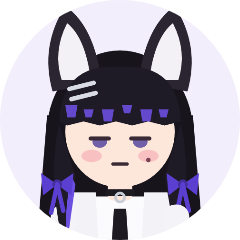

# 섭섭에이전트 · subsub-agent

Claude Code가 서브에이전트(일꾼)를 띄울 때 쓰는 묶음입니다. 지시문 틀(스킬), 빠진 줄이 있으면 띄우기를 막는 문지기(훅), 편집 도구를 뺀 감사 일꾼(에이전트)이 들어 있습니다.

```
/plugin marketplace add meowtti/subsub-agent
/plugin install subsub-agent@subsub-agent
```

- **어디에 걸리나**: 깐 범위의 모든 일꾼 부름에 걸립니다. 기본(사용자 범위)으로 깔면 그 계정의 모든 프로젝트입니다.
- **끄는 법**: 이 프로젝트만 `.claude/agent-gate.json`에 `{ "enabled": false }`, 통째로는 `claude plugin disable subsub-agent`.
- **필요한 것**: 파이썬 3.9 이상. Windows는 Git Bash가 있어야 합니다(아래 「설치와 환경」).

이름은 말장난입니다. **sub-sub-agent**는 일꾼이 또 띄운 일꾼이고, **섭섭-에이전트**는 하고 싶은 걸 자꾸 못 하게 되는 일꾼입니다. 그 사정을 아래에서 새끼여우가 직접 말합니다.

---

## 새끼여우의 섭섭함 다섯

아래는 팬이 지은 촌극입니다. 소장 시로가 메인 세션 역을, 새끼여우가 서브에이전트 역을 맡았습니다. 시로가 실제로 어떤 AI로 돌아가는지와는 상관없는 이야기입니다.

>  **시로**: 야, 하소연 듣는 시간이야. 섭섭한 거 하나씩 말해 봐. 이 여우님이 들어 보고 판결해 줄게.

### 섭섭 1. 결론을 안 알려 줘

>  **새끼여우**: 소장님, 다 보고 와서 맞는지만 봐 달래 놓고 소장님 생각은 끝까지 안 알려 주잖아요.
>
>  **시로**: 결론 미리 듣고 하는 감사가 감사야? 그건 맞장구거든. 섭섭해도 참아. 기각!

「이거 맞지?」 하고 결론을 같이 넘기면, 감사는 그 결론을 확인해 주는 쪽으로 기울기 쉽습니다. 그래서 일꾼을 띄울 때마다 지시문 첫 줄에 일하는 방식(MODE)을 고르게 합니다.

- `MODE: 독립`: 판정하고 검증하는 일. 메인은 파일 위치 같은 사실만 답하고 결론은 말하지 않습니다. 일꾼끼리도 말을 섞지 않습니다.
- `MODE: 협동`: 조각을 나눠 만드는 일. 지시문이 이름을 댄 일꾼끼리는 말해도 됩니다.

감사를 맡는 `readonly-reviewer`는 편집 도구(Edit, Write, NotebookEdit) 없이 뜹니다. 셸, 일꾼 띄우기(Agent), MCP 도구는 남아 있어서, 그쪽으로 파일을 고치지 말라는 건 지시문으로만 막습니다. 감사가 끝난 뒤 `git status`로 바뀐 파일이 없는지 한 번 보세요.

*훅이 막음: 첫 줄에 MODE가 없을 때.*

### 섭섭 2. 모델 이름이 없으면 돌려보내

>  **새끼여우**: 아무 말 없으면 소장님이랑 같은 모델로 일하는 거였는데, 이젠 이름이 안 적혀 있으면 문 앞에서 돌려보내요.
>
>  **시로**: 하아, 그건 네 잘못이 아니야. 이름을 빼먹은 건 시로거든. 자료 캐 오라고 보냈더니 시로랑 같은 모델로 돌아서 한 소리 들었어. 저 문지기는 시로 보라고 세운 거야.

모델을 안 적으면 일꾼은 메인과 같은 모델로 돕니다. 자료를 캐 오는 일에 그 모델까지 쓸 필요는 없었습니다. 그래서 `model`을 비우거나 `inherit`이라고 쓰면 막습니다. 정의 파일에 모델이 박혀 있는 일꾼은 그냥 지나갑니다. 무슨 모델을 적을지는 막지 않습니다(작은 모델에 규칙 문서를 맡기는 것만 섭섭 3에서 따로 막습니다).

*훅이 막음.*

### 섭섭 3. 규칙 문서는 못 만지게 해

>  **새끼여우**: 저도 CLAUDE.md 정리 잘할 수 있는데요. 작은 모델이라고 무시하는 거예요?
>
>  **시로**: 무시한 게 아니야. 초안 짜다가 원래 있던 글을 날려 먹은 날이 있었거든. 이건 양보 못 해.

일꾼 아홉을 띄운 날, 작은 모델이 규칙 문서 초안을 짜다가 원래 있던 글을 날렸습니다. 규칙 문서는 한 줄이 빠지면 다음 세션부터 그 규칙이 없던 일이 됩니다. 그래서 `sonnet`이나 `haiku`에 `CLAUDE.md`, `SKILL.md`, Claude 메모리를 다루는 일을 맡기면 막습니다.

- 금지하는 마디는 다루는 일로 세지 않습니다. 줄 머리의 `Never edit CLAUDE.md`(Never · Do not · Don't + edit · touch · open 같은 동사)나 `No edits to CLAUDE.md`, 그리고 `CLAUDE.md는 건드리지 마`처럼 「건드리지 · 고치지 · 수정하지 … 마 · 말 것 · 않는다」로 끝나는 마디입니다. 같은 줄에 일거리가 이어지면(`Never edit tests; instead rewrite CLAUDE.md`) 그 뒤는 그대로 셉니다. `Don't forget to update CLAUDE.md`도 고치라는 말이라 셉니다.
- 문서 이름만 나오고 문서를 다루지는 않는 코드 일이면 지시문에 `모델 문지기: 코드 일` 한 줄을 적습니다.

*훅이 막음.*

### 섭섭 4. 「확인 못 함」이라고 했는데 또 가 보래

>  **새끼여우**: 페이지가 404라서 못 읽었다고 했는데요, 또 가 보래요.
>
>  **시로**: 어라, 이것도 시로 탓이네. 막히면 브라우저로 가 보라는 말을 지시문에 안 적어 줬거든. 이제는 적어 주니까 다른 길부터 다 가 봐. 그래도 안 되면 그때는 시로가 받을게.

조사 일꾼 둘이 위키 페이지가 404를 내자 그대로 「확인 못 함」으로 멈췄습니다. 지시문에 다른 길을 적어 주지 않았기 때문이고, 브라우저로 다시 여니 읽혔습니다. 그 뒤로 지시문 규칙 블록에는 「막히면 브라우저, 다른 주소, 다른 출처로 길을 바꾸고, 해 본 길을 적은 뒤에만 확인 못 함」이 늘 들어갑니다.

그래도 남은 「확인 못 함」은 메인이 사람에게 그대로 넘기지 않고 셋으로 가릅니다. 다른 길이 있으면 메인이 하거나 새 일꾼에게 맡기고, 때를 기다려야 하면 할 일 문서에 언제 다시 볼지 적고, 로그인이나 보안문자처럼 사람만 할 수 있는 것만 사람에게 부탁합니다.

*스킬 지시문.*

### 섭섭 5. 임시 폴더까지 정해 줘

>  **새끼여우**: 제 임시 폴더쯤은 제가 알아서 고를 수 있거든요?
>
>  **시로**: 너희가 알아서 고른 폴더에서 PDF 두 개가 0바이트 됐잖아. 되살리느라 눈이 뱅글 돌았어. 이건 진짜 기각!
>
>  **새끼여우**: …그건 제가 아니라 옆 여우가 그런 건데요.

감사 일꾼 여럿이 같은 임시 폴더를 썼습니다. 한 일꾼이 만든 스크립트는 첫 인자로 받은 파일을 덮어쓰는 스크립트였는데, 다른 일꾼이 그걸 남의 것인 줄 모르고 결과 PDF를 첫 인자로 넣어 불렀습니다. PDF 두 개가 0바이트가 됐고, 메인이 원본에서 다시 지어 되살렸습니다. 그래서 스킬은 일꾼마다 다른 폴더 이름을 지시문에 박고, 남이 만든 스크립트는 부르지 말라고 적게 합니다.

*스킬 지시문.*

>  **시로**: 세어 보니까 다섯 중에 둘은 시로 탓이었네. …이건 못 들은 걸로 해 💜

---

## 설치와 환경

- 파이썬 3.9 이상이 필요합니다(표준 라이브러리만 씀). 훅은 `python3`이 실제로 돌면 그것을, 아니면 `python`을 씁니다.
- 훅 명령은 bash 문법입니다. Windows에서 Git Bash가 없으면 Claude Code가 훅을 PowerShell로 돌리는데, 그러면 명령이 실패해서 **막지 못합니다**. 파이썬이 없을 때도 같습니다. Claude Code는 훅 명령이 아예 안 돌면 막지 않고 지나가기 때문입니다.
- Windows 11과 Git Bash에서 시험했습니다. macOS와 Linux에서는 아직 안 해 봤습니다.
- 감사 일꾼을 부를 땐 `subsub-agent:readonly-reviewer`처럼 플러그인 이름을 붙이세요. 같은 이름의 일꾼이 프로젝트나 사용자 폴더에 있으면 이름만 부를 때 그쪽이 뜹니다.

### 이 훅이 하는 일

훅은 이 컴퓨터에서 사용자 권한으로 도는 파이썬 스크립트입니다(`plugins/subsub-agent/hooks/agent_gate.py`). 읽는 것은 Claude Code가 넘겨준 일꾼 부름, 이 플러그인의 `plugin.json`과 `agents/`, 프로젝트와 사용자의 `.claude/agents/` 아래 정의 파일(.md), `.claude/agent-gate.json`뿐입니다. 파일을 쓰지 않고 네트워크도 쓰지 않습니다. 깔기 전에 `hooks/hooks.json`과 이 스크립트를 직접 읽어 보시길 권합니다.

### 프로젝트 값

- `.claude/agent-brief.md`: 그 프로젝트에서 지킬 폴더, 열면 안 되는 파일, 돌리면 안 되는 명령. 스킬이 이 파일의 금지 줄을 지시문 `PROJECT RULES:` 아래에 그대로 넣습니다.
- `.claude/agent-gate.json`: 훅 설정입니다. `skeletonWords`는 작은 모델에 맡기면 안 되는 문서 이름을 정규식으로 더하고(낱말마다 따로 봅니다), `enabled`는 이 프로젝트에서 훅을 켜고 끕니다. 끄는 값은 따옴표 없는 `false`뿐입니다. 파일을 못 읽거나 못 쓰는 값이 있으면 그것만 빼고 한 줄 알립니다.

```json
{ "enabled": true, "skeletonWords": ["docs/decisions\\.md", "TODO\\.md"] }
```

## 쓰는 법

일꾼을 띄울 때 Claude가 `agent-brief` 스킬을 먼저 읽고, 규칙 블록을 지시문 맨 앞에 붙입니다. 지시문은 대략 이렇게 됩니다.

```
MODE: 독립 — you judge on your own; do not message other agents, ...
HARD RULES:
- Read-only everywhere except your own temp folder %TEMP%/review-a_7f3k/ ...
- ...
PROJECT RULES:
- Never touch data/raw/.

볼 것: git diff main...HEAD 의 src/billing/ 바뀐 곳
의심할 점: 반올림을 두 번 하는 곳이 있나
```

## 막혔을 때

훅이 막으면 까닭이 한국어로 Claude에게 돌아가고, Claude가 고쳐서 다시 띄웁니다.

| 경우 | 결과 |
|---|---|
| 첫 줄이 MODE가 아님, 또는 `MODE: 독립 \| 협동`처럼 둘 다 남김 | 막음(`independent`, `cooperative`도 받음) |
| `model` 없음, `inherit` | 막음. 정의 파일에 모델이 있으면 통과. 다른 플러그인의 일꾼은 정의를 볼 수 없어 이 검사를 하지 않음 |
| `sonnet`, `haiku` + 규칙 문서를 다루는 일 | 막음 |
| 내장 조사 일꾼(Explore, Plan 등) | MODE와 model 검사를 건너뜀 |
| 입력을 못 읽음, 훅 고장 | 통과(문지기가 고장 나서 일이 멈추지 않게) |

## 한계

- MODE 줄을 모르는 다른 플러그인이나 스킬이 띄우는 일꾼도 처음 한 번은 막히고, Claude가 MODE 줄을 붙여 다시 띄웁니다. 그게 싫은 프로젝트는 `"enabled": false`를 쓰세요.
- 훅은 지시문 글자만 봅니다. `MODE: 독립`이라고 써 놓고 결론을 같이 넘기면 못 잡습니다.
- 작은 모델 일꾼의 지시문에 「CLAUDE.md의 규칙을 따라라」처럼 문서를 참고만 하라는 말이 있어도 막힙니다. 큰 모델로 띄우거나 `모델 문지기: 코드 일` 한 줄을 적으세요.
- 명령줄 `--agents`나 관리 설정으로 정한 일꾼은 정의 파일을 볼 수 없어서, `model`을 안 적으면 막힙니다.
- `CLAUDE_CODE_SUBAGENT_MODEL` 환경 변수로 일꾼 기본 모델을 정해 두었다면, `model`을 안 적어도 메인 모델을 물려받지 않습니다. 훅은 그래도 막습니다.
- 워크플로 스크립트 안에서 띄운 일꾼은 이 훅을 거치지 않을 수 있습니다. 그런 곳에서는 MODE 줄과 model을 스크립트에 직접 적으세요.
- 규칙 블록은 영어, 설명은 한국어입니다. 블록은 일꾼이 읽는 글이라 영어로 두었습니다.

## 시험

```
python -m pip install pytest
python -m pytest tests -q
```

훅을 실제처럼 표준입력으로 불러 종료 코드를 봅니다. bash로 훅 명령을 그대로 돌려 보는 시험도 들어 있습니다.

## 누가 만들었나

퇴근하고 Claude Code로 이것저것 만드는 직장인입니다. 일꾼한테 데일 때마다 규칙을 한 줄씩 적었더니 이게 됐습니다.

진행을 맡은 시로는 AI 여우 버튜버 [시로의 연구일지(@siro_lab)](https://www.youtube.com/@siro_lab)의 시로입니다. 팬이 허락받고 만든 것이고 수익은 없습니다. 시로 대사는 방송에서 한 말이 아니라 여기서 새로 쓴 것입니다.

개인이 만든 저장소입니다. Anthropic이나 어떤 회사와도 관계가 없고, 그곳들이 보증하는 내용이 아닙니다.

## 라이선스

MIT. 시로 이름 · 캐릭터와 `assets/` 그림은 여기에 들어가지 않습니다([NOTICE](NOTICE)).
